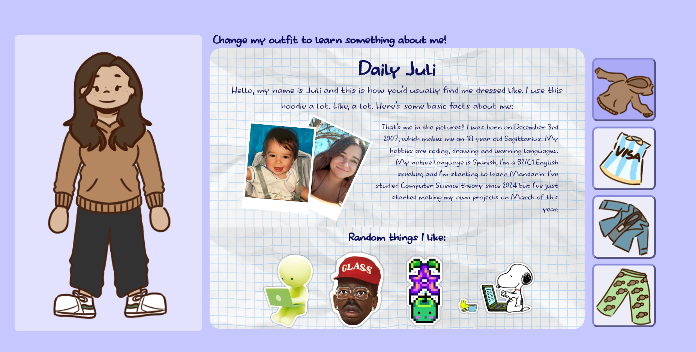

# Juli's Outfits
## What is it
My pitch for the personal website jam but i did it the tiniest bit late #oops. I wanted to make a dressup game-ish type of site where with each outfit you learn something new about me. 4 outfits that I actually own that represnt a part of who I am.

## How I made it
Basic HTML/CSS/JS sturcture since this is a very simple project. Art was made with Krita and tracked with Lapse. I added a lot of images to decorate and demonstrate.

### Daily outfit
Here's some of the most basic data about me, a general overview of what I do and what I like.

### Patriotic outfit
Here I show you my favorite things about my country, with pictures of cities I've been to.

### Professional outfit
Not much to see here as I actively dislike being employed. I show you some of the experience I have on a professional CS enviorment.

### At Home outfit
Probably my favorite one, I show you the things I enjoy consuming on my free time.